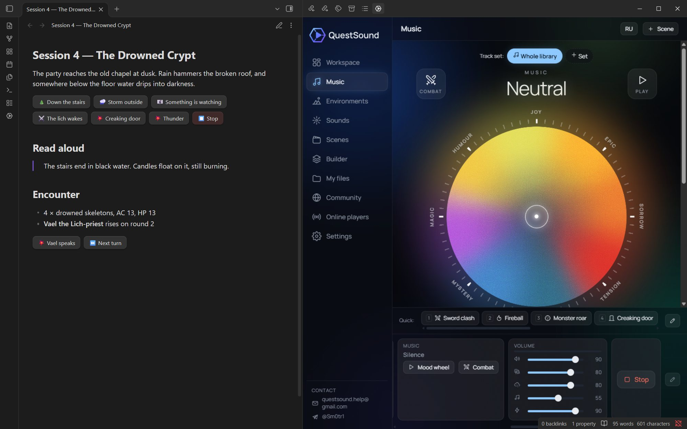
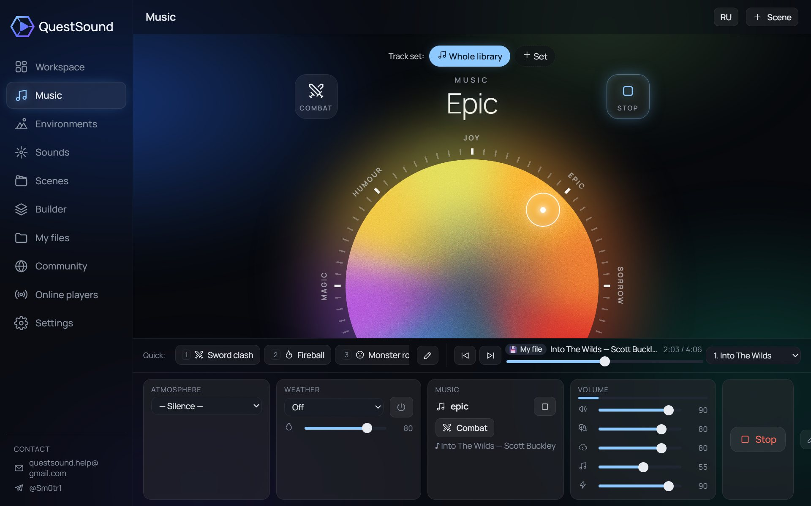
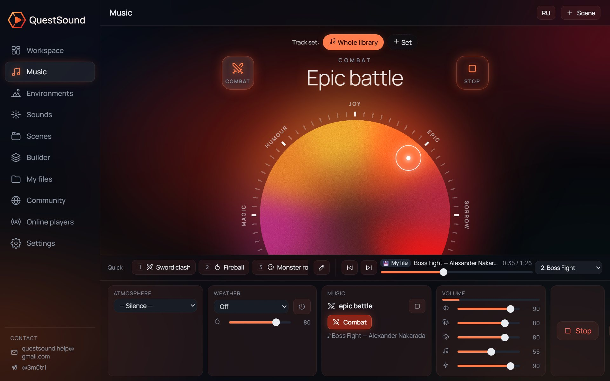
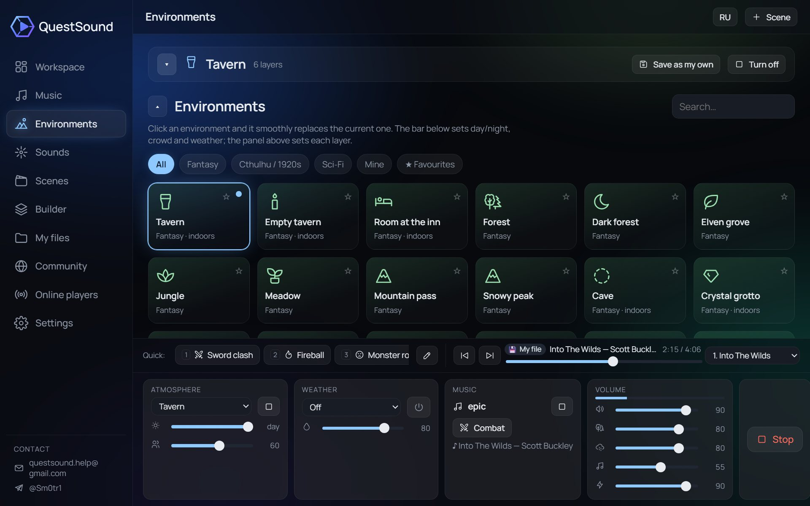
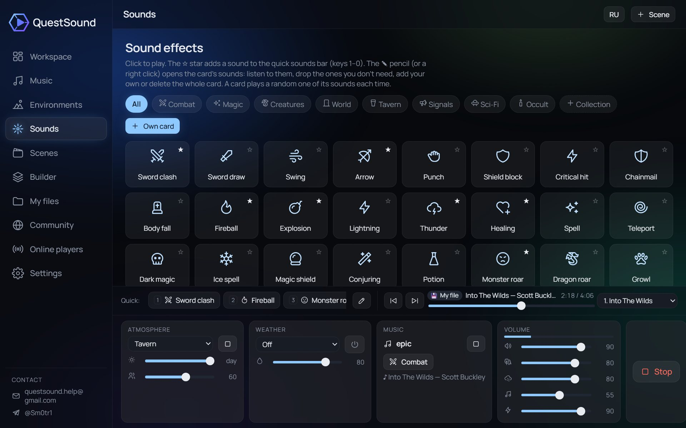

# QuestSound for Obsidian

Music, ambience and sound effects for tabletop RPG sessions, right next to your campaign notes.



QuestSound opens in the right side bar and keeps playing while you write. Your notes control it:

- **Mood wheel**: pick joy, epic, sorrow, tension, dread, mystery, magic or humour, and how strong it should be. A separate set of combat tracks is one button away.
- **81 environments** (tavern, dungeon, forest, ship, city, Call of Cthulhu, sci-fi…), **10 kinds of weather** and **76 sound effects**, all real recordings.
- **Scenes**: save the current sound and switch to it with one click, a command or a hotkey.
- **Buttons in notes** and **note sound**: a note can start its scene when you open it.
- **Online rooms**: players hear the same sound in their browser by a link or a 6-digit code.

The interface follows Obsidian's language (English or Russian). Note commands accept names in either language.

## Mood wheel

The direction picks the mood, the distance from the centre picks how strong it is: near the edge the music plays at full power, near the centre it is softer.



**Combat** switches to battle tracks of the same mood. The whole panel turns red while the fight lasts, so you can see at a glance that combat music is on.



## Environments and weather

Each environment is a mix of real recordings: fire, crowd, rain on the roof, wind, birds. Click one and it fades in over the current one. Day or night, crowd size and weather are set below; every layer has its own volume.



## Sound effects

Sword clash, fireball, thunder, a monster's roar: one click, or keys 1–0 for the sounds you star. Each card plays a random take, so a repeated hit doesn't sound the same twice.



## Buttons in notes

````
```questsound
scene: Tavern
env: Forest | Into the woods
mood: epic 0.9
mood: dread fight
set: Dark fantasy
fight: off
sfx: Sword clash
weather: Rain
stop
```
````

Each line is a button; text after `|` is its caption. `mood` takes a wheel zone, a strength from 0 to 1 and the word `fight` for combat music. Also: `cue: Villain theme` (a theme for a key moment) and `turn` (next turn in the initiative tracker).

## Note sound

Add a `questsound` property to a note and its sound starts when the note is opened:

```yaml
---
questsound:
  - scene: Tavern
  - weather: Rain
---
```

A bare name (`questsound: Tavern`) is a scene. Turn it off in the plugin settings; the command “Play this note’s sound” starts it by hand.

## Commands

Open the panel, play a scene / environment / mood / sound / theme, wheel track set, combat music on/off, music on/off, next combat turn, stop everything, and “Scene #1…9”. Assign hotkeys to any of them in Settings → Hotkeys.

## Network use and privacy

- The panel is the QuestSound web app (https://questsound.ru by default; the address can be changed in the plugin settings) loaded in a frame, so the plugin **needs an internet connection**. Music and sounds stream from that server.
- The plugin does not read or send your notes. It only sends the command of a button or note property you use to the panel.
- Your scenes and settings are stored inside the panel (browser storage of Obsidian), not in the vault. Cloud sync, online rooms and community uploads happen only when you use them in the panel. Details: https://questsound.ru/privacy/
- No analytics run inside the Obsidian panel.
- If you add YouTube or SoundCloud tracks in the panel, their players load from those services.

## Credits

Music by Alexander Nakarada, Scott Buckley and Kevin MacLeod (CC BY 4.0). Sounds from freesound.org (CC0).

---

## По-русски

QuestSound — музыка, звуки окружения и эффекты для НРИ в боковой панели Obsidian. Круг настроений и боевая музыка, 81 окружение, 10 видов погоды, 76 эффектов, сцены, кнопки в заметках и звук при открытии заметки, комнаты для игры по сети.

Кнопки пишутся и по-русски:

````
```questsound
сцена: Таверна
окружение: Лес | Входим в чащу
музыка: эпос 0.9
музыка: жуть бой
звук: Удар мечей
погода: Дождь
стоп
```
````

Плагину нужен интернет: панель — это сайт https://questsound.ru во фрейме. Заметки плагин не читает и никуда не отправляет. Подробнее: https://questsound.ru/obsidian/
